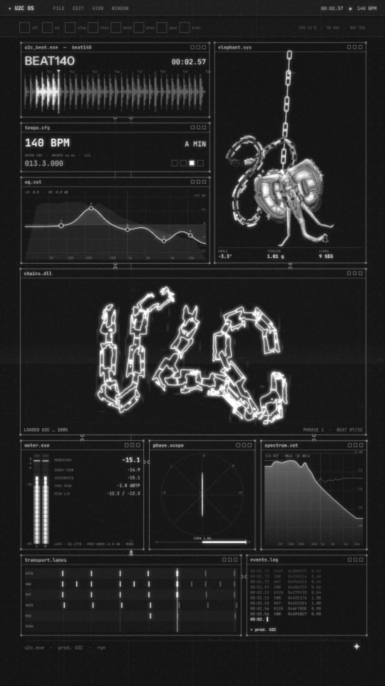
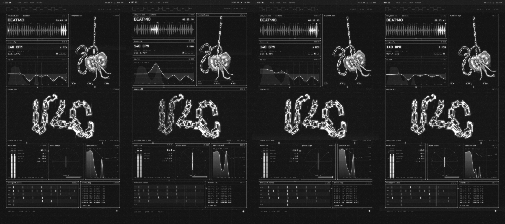
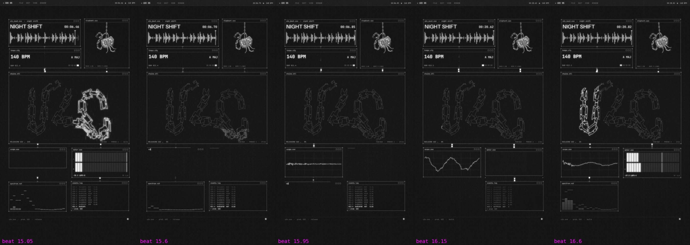

# BRIEF: U2C.EXE beat preview (15 s, 9:16 Reels)

## Job
A 15 s vertical beat preview for Instagram Reels, TikTok and Shorts (1080×1920, 30 fps, H.264 + AAC, -14 LUFS), plus a 16:9 cut for YouTube. It is a motion graphic for a beat called **"Pendant"** (142 BPM, F# minor, prod. @uche2crazy). Everything on screen is driven by the audio.

## Brand (from /home/user/u2c-visualizer/BRIEF.md and DESIGN-TOKENS.md)
- **Colours: only these.** Charcoal `#161616` / `#232323`, chains `#c8c8c8`. Rust `#6e4433`, tan `#c4a57a`, ink `#2a1710`. Amethyst `#1d1426`, lilac `#b79ad8`, magenta `#e07ad0`, ruby `#e0475f`, gold `#f2c14e`. Alpha tints of these are the only variation allowed.
- **Type.**
  - Instrument Sans 600 for titles, with tight tracking.
  - JetBrains Mono for every label, readout and timecode, set uppercase and letter-spaced.
  - A serif italic for accents. Here that is Instrument Serif Italic: Iowan Old Style and Palatino are not installed on Linux, and Instrument Serif pairs with Instrument Sans.
- **Logo.** The U2C chain logo (`assets/u2c-links.png` atlas, 8 pieces, letters U / 2 / C). It **dissolves and rebuilds letter by letter and never breaks**: pieces never move, and a ghost outline always stays.
- **Mascot.** The purple elephant pendant (`assets/elephant.png`, bail knot at 343,197). It swings on a chain from code: a pendulum with a period of one bar, kick-pumped, plus a lagged secondary sway.
- **Aesthetic.** A calm, precise cyberpunk "U2C.EXE" OS:
  - hairline wireframe `.exe` windows (■ TITLE header, unit, ▢▢▢ controls, corner notch)
  - cables with signal dots
  - pro audio meters.
- **Restraint.** No glitch on kicks. Reactivity is musical: a 0.35 % camera breath and a 1.2 % logo punch on kicks, gold sparkles on snares, signal dots on the onsets.

## Screens we already own (U2C.EXE, /home/user/u2c-visualizer/shots/)
- `u2cexe-916.png` is the layout ancestor of this film's desktop: a stack of beat.exe, elephant.sys, chains.dll, meter / phase / spectrum and transport.
- `u2cexe-phrase-916.png` and `u2cexe-turnover-916.png` show the logo in its dissolve states.
- `lab-916.png` and `scope-916.png` are the alternative looks we did not use here.

  

## References
- **Kollide noteframe frames** (`refs/ref-exe.webp`, `refs/ref-lab-nodes.webp`): nested hairline windows, node cables, a timecode as type.
- **Aurora by Joe Croskey** (joecroskey.com/Aurora), the bar for meter design. Borrowed language, not assets:
  - panel header ■ + uppercase mono + unit at right (dBFS)
  - frequency axis 20 / 632 / 20k
  - band-coloured L/R waveform
  - segmented level bars with a white peak-hold line
  - **Integrated LUFS as the big number**, with M / S small beneath
  - polar M/L/R/S scope with a −1…+1 correlation slider
  - a translucent "folded-light" 3D spectral surface.
- **whatships.com, "Factory – Security Factory"** (Factory, 0:14): a dark grain field and hairline map, nodes with mono chips (SIGNALS → TRIAGE → REMEDIATION), one warm signal dot travelling a cable, the logo resolving from dithered pixel blocks, and a held end card. We copy:
  - **pacing:** one idea per 2-3 s, held end card about 2 s
  - **transitions:** a pixel-block resolve for the logo, signal-dot hand-offs between nodes
  - **type:** small uppercase mono chips.
- **whatships.com, "Interactions — search web animations by motion"** (Filip Wojda, 0:49): hairline ruler ticks and bracket lines that draw on, then calm big type held for a beat. We copy:
  - **borders that draw on** instead of fades
  - **calm holds** on type
  - **eased glides** (power2.inOut) rather than whips.
- Research frames: `research/` (contact strips of both whatships videos, Aurora screenshots).

## Music
`tools/make_beat.py` synthesises a 30 s, 142 BPM, F# minor stereo beat at 48 kHz (`audio/beat-30s.wav`):
- kick, half-time snare + clap
- hats with triplet / 32nd rolls and open hats
- a sliding 808 that glides into the next root, with an octave dive in the break
- a detuned i–VI–iv–v chord pad
- a pentatonic pluck hook with ping-pong delay
- sidechain ducking.

numpy renders the stems; **ffmpeg** does the bus compression, EQ, limiter and the loudnorm master.

`tools/analyze.py` chose **1.690–16.690 s** (bars 2–9.9) as the best 15 s. It starts on a downbeat with one bar of pad and hats, **the drop hits at 1.69 s**, the break is bar 6 (8.45 s) and the re-drop is bar 7 (10.14 s). The clip is loudness-normalised (two-pass, linear) to **-14.0 LUFS integrated, -3.5 dBTP**.

## Audio → data (all offline, fed to the composition as `film/assets/analysis.js`)
- **Onsets.** Spectral flux per band (kick 30–150 Hz linear, snare 1–5 kHz, hats 7–16 kHz), scored against the synth's ground truth:
  - kick recall 25/25, precision 0.89
  - snare 7/7, precision 1.00
  - hats 86/95, precision 0.71.
- **Tempo** detected at 142.0 BPM by autocorrelation. The downbeat phase comes from a kick-on-1 / snare-on-3 fit.
- **Per frame** (450 frames):
  - peak and RMS L/R, with a 1.2 s hold and 18 dB/s fall
  - **BS.1770 momentary, short-term and gated integrated LUFS** (ours -14.04 vs ffmpeg ebur128 -14.0)
  - 4× true peak
  - a 96-bin log spectrum with a peak hold
  - 6 band levels
  - an EQ envelope vs pink at 6 nodes
  - correlation and width
  - 192 vectorscope points per frame
  - the 808 f0 track
  - a band-coloured waveform overview.

## Braindump
- Frame 0 is fully drawn: grid, ghost logo, boot log. There is no fade-in.
- The biggest moment is the drop at 1.69 s: U, 2, C lock in on the first three kicks.
- The break gets the contrast: a close-up while the logo dissolves letter by letter, meters dimmed, and the 808 dive visible on the spectrum and in the 808 F0 lane.
- The end card lands on the bar-8 snare (12.68 s). It holds about 2.3 s and sits inside the 9:16 safe box (y 288–1248). The pendant hangs whole underneath.
- Every number on screen is real: LUFS, true peak, correlation, 808 Hz, the swing angle.
- Later: vocal tags. `tools/transcribe.py` (faster-whisper) gives word timestamps to drive tag captions.
